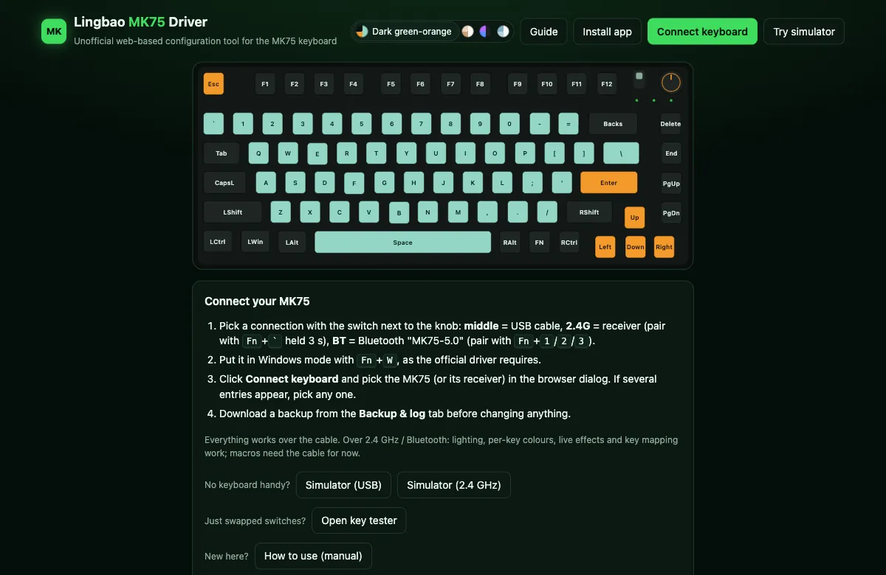
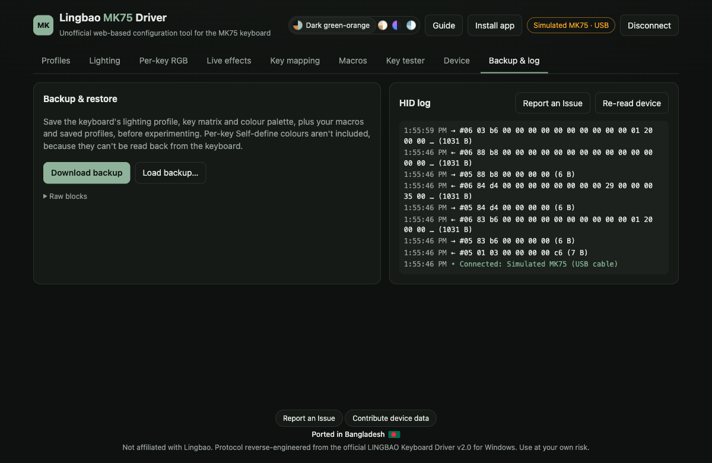
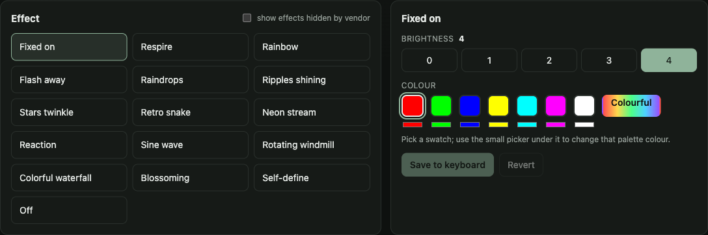
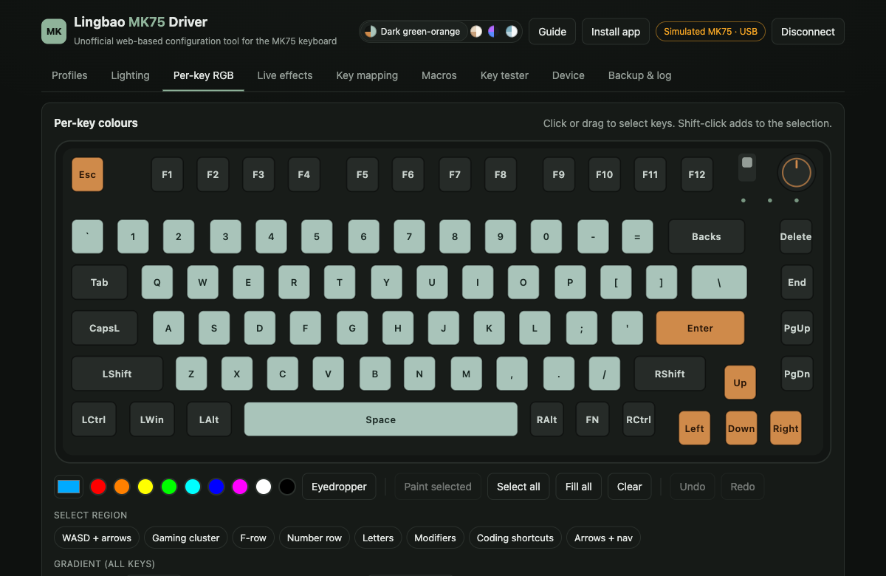
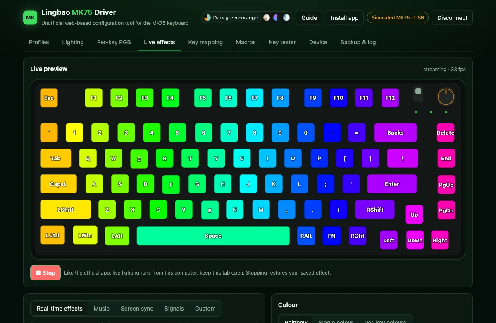
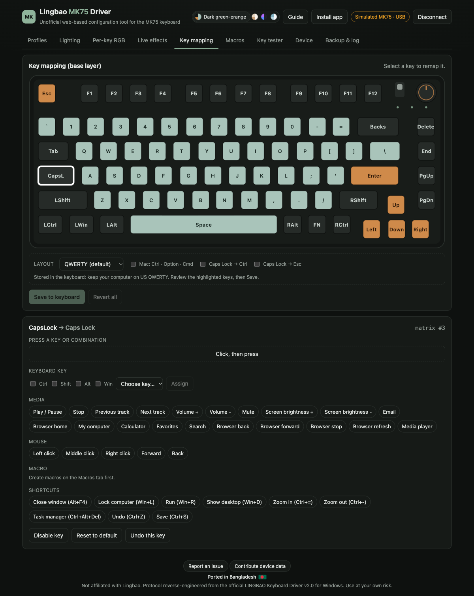
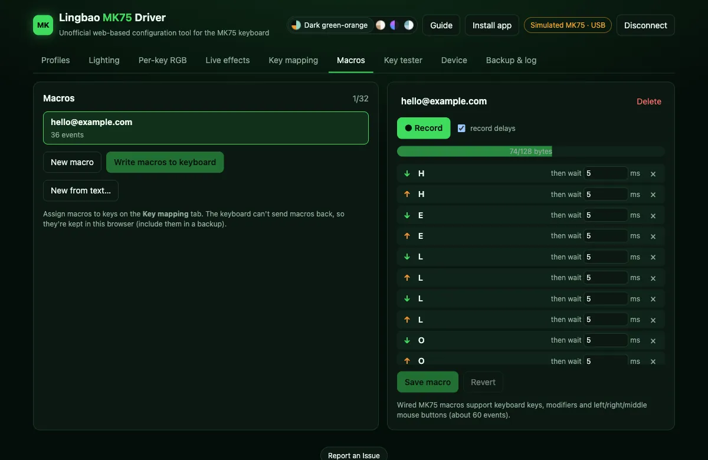
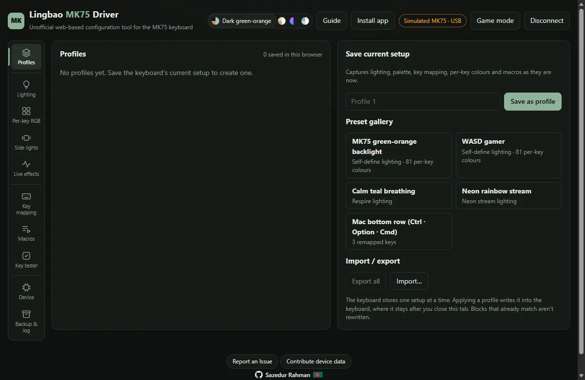
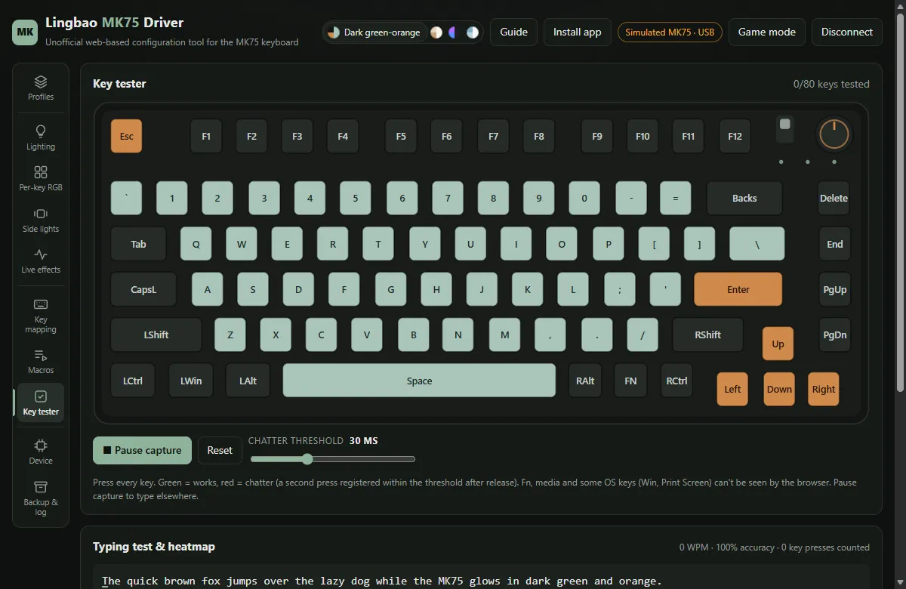
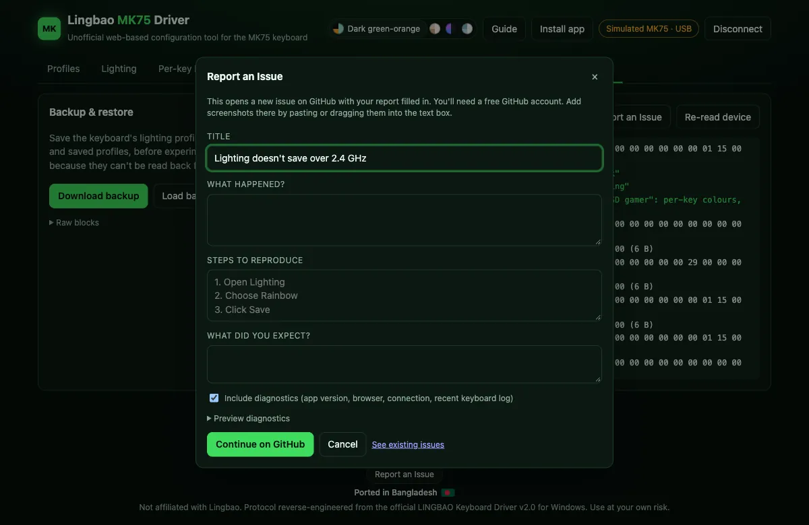

# User manual

This manual shows you how to connect your **Lingbao MK75** keyboard to the MK75 Driver website and use its
features. No technical knowledge needed.

**Website:** https://mk75-web.vercel.app/

---

## What you need

- A **Lingbao MK75** keyboard.
- A **Windows, Mac, Linux or Chromebook computer**. Phones and tablets don't work.
- One of these browsers: **Google Chrome**, **Microsoft Edge** or **Opera**. Safari and Firefox can't talk to
  keyboards.
- The **USB cable** that came with the keyboard (recommended), or the **2.4 GHz USB receiver**.

---

## Connect your keyboard

### With the USB cable (recommended)

1. Find the small **switch next to the knob** (top right of the keyboard). Slide it to the **middle position**
   (the keyboard icon).
2. Plug the keyboard into your computer with the **USB cable**.
3. Press **Fn + W** on the keyboard (this puts it in Windows mode, which the driver needs; do it on a Mac too).
4. Open **https://mk75-web.vercel.app/** in Chrome, Edge or Opera.
5. Click the green **Connect keyboard** button.
6. A small window from the browser appears with a list of devices. Click your keyboard (it may be called
   **MK75**, **USB Keyboard** or similar), then click **Connect**.
7. Done: the tabs appear (Profiles, Lighting, Per-key RGB…). You're connected.

**Next time**, just click **Reconnect MK75** on the start page. No list to choose from.

*The start page: click Connect keyboard (top right).*

### With the 2.4 GHz receiver

1. Slide the switch next to the knob to **2.4G**.
2. Plug the small **USB receiver** into your computer.
3. If the keyboard was never paired with this receiver: hold **Fn + `** (the key left of 1) for **3 seconds**
   until the light blinks.
4. Open the website, click **Connect keyboard**, choose the **receiver** in the list, and click **Connect**.

Over 2.4 GHz everything works, including saving macros.

### With Bluetooth (experimental)

1. Slide the switch to **BT**, then hold **Fn + 1** (or 2 or 3) for **3 seconds** to pair.
2. Pair **"MK75-5.0"** in your computer's Bluetooth settings first.
3. Then click **Connect keyboard** on the website and choose the MK75.

If the keyboard doesn't show up in the list over Bluetooth, use the cable or receiver instead.

### Before you change anything: make a backup

Go to the **Backup & log** tab and click **Download backup**. Keep the file. If you ever don't like your
changes, click **Load backup…** and restore it.

*Backup & log: Download backup saves your setup; Load backup… restores it.*

---

## Everyday tasks

### Change the lighting effect
1. Open the **Lighting** tab.
2. Click an effect (for example **Rainbow** or **Respire**).
3. Choose brightness, speed and colour on the right.
4. Click **Save to keyboard**.

*Lighting: pick an effect on the left, set brightness, speed and colour on the right, then Save to keyboard.*

### Give each key its own colour
1. Open **Per-key RGB**.
2. Click keys (or drag across several) to select them. Pick a colour and click **Paint selected**.
3. Shortcuts: **Select region** (for example WASD), **Apply gradient**, or **Match a colourway** for your
   keyboard's colours.
4. Click **Save to keyboard & activate Self-define**.

You can also put a **picture or GIF** on your keys: scroll down to **Image / GIF to keys** and choose a file.

*Per-key RGB: select keys, pick a colour, paint. Region buttons and gradients save time.*

### Light shows, music and more (Live effects)
1. Open **Live effects**.
2. Choose a type:
   - **Real-time effects:** animated patterns
   - **Music:** lights move to your music (click *Share system / tab audio…* first)
   - **Screen sync:** colours follow your screen
   - **Signals:** timer, clock or battery shown on the keys
   - **Custom:** design your own effect
3. Click **▶ Start**. Click **■ Stop** to go back to your saved lighting.

Live effects run from your computer, so **keep the website open** while you use them.

*Live effects: the preview shows what your keyboard is doing. ■ Stop returns to your saved lighting.*

### Change what a key does
1. Open **Key mapping** and click the key you want to change.
2. Choose its new job: press a key combination, pick a media key (volume, play/pause), a mouse button, a shortcut,
   or a macro. You can also **Disable** it.
3. Click **Save to keyboard**.

To change the whole layout (Colemak, Dvorak, Mac-style keys), use the **Layout** box on the same tab.

To change what a key does **while Fn is held** (for example Fn + F12), click **Fn layer** first (experimental,
current MK75 boards). The mode, pairing and battery keys are locked so you can't lose them, and **Restore Fn layer**
puts back the Fn layer as the app first read it.

*Key mapping: click a key (here Caps Lock), choose its new job below, then Save to keyboard.*

### Make a macro (one key types many keys)
1. Open **Macros** and click **New macro**.
2. Click **● Record**, type your keys, then click **■ Stop recording**. Or click **New from text…** and just type
   the text you want the key to type.
3. Click **Save macro**.
4. Go to **Key mapping**, click a key, choose your macro under **Macro**, click **Assign macro**, then **Save
   to keyboard**.

Macros save over the cable or the 2.4 GHz receiver. On current MK75 boards the repeat choices are **Play once**,
**Repeat until any key** and **Toggle** (press the key again to stop).

*Macros: a macro made with New from text…. Each step and its delay can be edited.*

### Save and switch setups (Profiles)
1. Set up the keyboard the way you like.
2. Open **Profiles**, type a name (for example "Gaming") and click **Save as profile**.
3. Later, click **Apply** on any profile to put it back on the keyboard.

Use **Share link** to send a setup to a friend. Opening the link shows a preview with an **Apply** button.

*Profiles: Apply puts a saved setup on the keyboard. The Preset gallery has ready-made looks.*

### Test your keys
Open **Key tester** (or **Open key tester** on the start page; no connection needed). Press every key: working keys
turn green. Keys that "double type" turn red. This is handy after changing switches.

*Key tester: keys you've pressed turn green with a press count. Red means a switch double-types.*

### Install it like an app
Click **Install app** at the top (Chrome or Edge). It then opens from your Start menu or Dock in its own window and
works offline.

---

## Good to know

- **Your settings stay on the keyboard.** After you click Save, you can close the website, unplug the keyboard or
  use another computer. Your lighting, key changes and macros stay.
- **Only live effects need the website open.** The keyboard can't play them by itself.
- **Pick the colour theme** of the website at the top (it matches the MK75 colourways). On your first visit the site
  asks which colourway you own.
- **The keyboard's own shortcuts** (Fn + keys) are listed in the **Device** tab.

---

## Troubleshooting

**The "Connect keyboard" button is grey or nothing happens.**
Use Chrome, Edge or Opera on a computer. Safari, Firefox and phones aren't supported.

**My keyboard isn't in the list.**
- Check the switch is in the **middle position** (cable) or **2.4G** (receiver).
- Press **Fn + W**, then try again.
- Try another USB port or cable.
- On Linux, see "Linux permissions" in the README.

**It says the keyboard isn't connected (2.4 GHz).**
The keyboard is asleep or not paired. Press any key to wake it, or pair again (switch on **2.4G**, hold
**Fn + `** for 3 seconds).

**Saving macros doesn't work.**
If the app says the macros are too long, shorten or remove some: the keyboard holds 4 KB of macros (about 1,000
key events). If it says the receiver type can't store them, connect the USB cable instead.

**Live effects stopped.**
They only run while the website is open. Start them again from **Live effects**.

**Something looks wrong after a change.**
Restore your backup (**Backup & log → Load backup…**), or reset the keyboard with the official LINGBAO Windows
driver.

---

## Report a problem

Click **Report an Issue** at the bottom of any page (or in **Backup & log**):
1. Give it a short title and describe what happened.
2. Leave **Include diagnostics** ticked. It adds technical details that help fix the problem.
3. Click **Continue on GitHub**. A new issue opens with everything filled in.
4. Add screenshots by pasting or dragging them into the text box, then click **Submit new issue**.

You need a free GitHub account to submit. You can also see existing reports at
https://github.com/sazedur-siam/web-driver-mk75/issues.

*Report an Issue: fill in what happened, then Continue on GitHub and add screenshots there.*

---

## Frequently asked questions

**Is it safe?** The website sends the keyboard the same commands as the official driver and only changes the
settings you change. Still, keep a backup.

**Do I need to install anything?** No. Optionally click **Install app** to keep it like a normal program.

**Does it work without internet?** Once you've opened it (or installed it), yes.

**Is it official?** No. It's an unofficial tool made by a fan and not affiliated with Lingbao.
